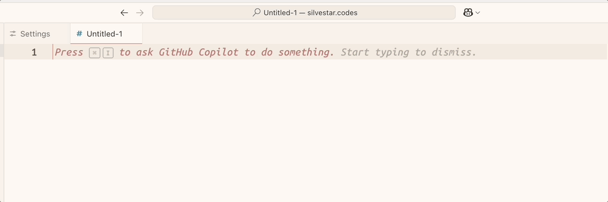

# Clamp it!



Clamp it! is a VS Code extension that turns a few numbers into a fluid CSS `clamp()` value.

I use fluid font sizes on every project. I got tired of calculating slopes and intercepts in an online tool, so I built this to do it right in the editor.

---

> As of version 0.0.9, the base font size is the last parameter.

---

## Usage

1. Write the values in this order, then select them:

```css
mobileFontSize, desktopFontSize, viewportMin, viewportMax, baseFontSize
```

For example:

```css
16, 20, 600, 1200, 16
```

2. Open the command palette (`Cmd+Shift+P` on Mac, `Ctrl+Shift+P` on Windows and Linux).
3. Run `Clamp it!`.

The selection becomes this:

```css
clamp(1rem, calc(0.75rem + 0.667vw), 1.25rem) /* min: 16px, max: 20px */
```

If you don't want the comment, turn off `clampExtension.showComments`:

```css
clamp(1rem, calc(0.75rem + 0.667vw), 1.25rem)
```

## Input

- Only the first two values are required. The rest come from the settings.
- Leave a value empty to use the setting. For example, `16, 20, , , 14` uses the default viewports and a 14px base font size.
- Values can have a `px` unit, like `16px, 20px`.
- If the mobile size is bigger than the desktop size, the value shrinks as the screen grows.
- If both sizes are the same, you get a plain `rem` value. No need for `clamp()` there.
- It works with many selections at once.

## Settings

| Setting | Default | Description |
| --- | --- | --- |
| `clampExtension.globalMinViewport` | `600` | The minimum viewport width in pixels. |
| `clampExtension.globalMaxViewport` | `1200` | The maximum viewport width in pixels. |
| `clampExtension.baseFontSize` | `16` | The base font size for the `rem` conversion. |
| `clampExtension.showComments` | `true` | Add a comment with the min and max sizes. |

You can set them per project in `.vscode/settings.json`:

```json
{
  "clampExtension.globalMinViewport": 500,
  "clampExtension.globalMaxViewport": 1500,
  "clampExtension.baseFontSize": 14,
  "clampExtension.showComments": true
}
```

## Development

Here's how to run the extension locally:

1. Clone the repo:

```sh
git clone https://github.com/maliMirkec/clamp-it.git
cd clamp-it
```

2. Install the dependencies:

```sh
npm install
```

3. Open the project in VS Code and press `F5`. VS Code opens a new window with the extension.

4. Run the tests:

```sh
npm run test:unit
```

---

> Built with assistance of ChatGPT. ¯\\_(ツ)_/¯
